hi, i'm max.

  <picture>
    <source media="(prefers-color-scheme: dark)" srcset="./metrics.dark.svg">
    
  </picture>
  <picture>
    <source media="(prefers-color-scheme: dark)" srcset="./metrics.langs.dark.svg">
    
  </picture>

